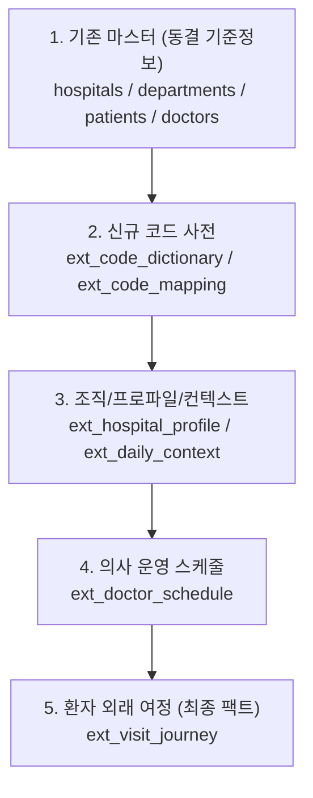

# 📋 [Team 3] 데이터 확장 및 거버넌스 공통 규약서 (Common Contract)

> **문서명:** `common_contract.md`  
> **버전:** v1.0.0  
> **기준일:** 2026-10-15  
> **적용 범위:** Team 3 병원 EMR Medallion 데이터 파이프라인, 신규 확장 테이블(`ext_*`), 데이터 생성 및 정제 전반

---

## 1. 파일 포맷 및 인코딩 (File Format & Encoding)
- **문자 인코딩:** `UTF-8` (BOM 없음)
- **컬럼 구분자:** 쉼표 (`,`)
- **줄 바꿈:** 개행 문자 `\n` (LF 표준, Windows 환경 CRLF 자동 정규화)
- **헤더:** 반드시 첫 번째 행(Row 1)에 영문 컬럼명 명시 (공백/특수문자 금지)
- **따옴표 규칙:** 텍스트 내 쉼표나 개행이 포함된 경우에만 큰따옴표(`"`)로 감쌈

---

## 2. 기존 자산 불변의 원칙 (Immutability Principle)
- **기존 테이블 읽기 전용 (SELECT Only):** 기존 17개 실버 테이블 및 `code_dictionary`, `legacy_code_mappings`를 포함한 모든 기존 자산은 **수정(UPDATE/DELETE/ALTER)을 절대 금지**하며 오직 `SELECT` 조회만 허용한다.
- **수정 요청 금지:** 기존 테이블에 필요한 컬럼이나 속성이 없더라도 기존 테이블 스키마 수정을 요청하지 않는다.
- **신규 테이블 원칙:** 추가 데이터가 필요할 경우 반드시 **신규 확장 테이블(`ext_*`)**을 생성하여 결합한다.

---

## 3. 신규 테이블 명명 규칙 (Naming Convention)
- **테이블 접두어:** 신규 생성 테이블은 반드시 `ext_<도메인명>` 형식을 따른다.
- **스키마 격리:** 별도의 확장 데이터베이스 스키마(예: `team3_extension` 등)가 정의되어 있을 경우 해당 스키마 내에 생성한다.
  - 예시: `ext_visit_journey`, `ext_doctor_schedule`, `ext_hospital_profile`, `ext_daily_context`

---

## 4. 신규 식별자(ID) 네임스페이스 (ID Namespace Registry)
- 모든 신규 테이블의 기본키(PK)는 영문 3자리 접두어 + 언더스코어(`_`) + 9자리 일련번호(`%09d`) 체계를 준수한다.
- 새로운 테이블을 설계할 때는 아래 네임스페이스 표에 접두어를 사전 등록해야 한다.

| 테이블명 | PK 컬럼명 | 식별자 접두어 | 포맷 예시 | 설명 |
| :--- | :--- | :---: | :---: | :--- |
| `ext_visit_journey` | `journey_id` | **`JRN_`** | `JRN_000000001` | 환자 내원 및 외래 여정 추적 ID |
| `ext_doctor_schedule` | `schedule_id` | **`SCH_`** | `SCH_000000001` | 의사별 상세 근무 및 진료 스케줄 ID |
| `ext_hospital_profile` | `profile_id` | **`PRF_`** | `PRF_000000001` | 병원별 인프라 및 운영 프로파일 ID |
| `ext_daily_context` | `context_id` | **`CTX_`** | `CTX_000000001` | 일별 기상/이벤트 외래 환경 컨텍스트 ID |

---

## 5. 기존 외래키 참조 준수 (Frozen Valid Keys Reference)
- 신규 테이블에서 기존 테이블의 마스터/엔티티를 참조할 때는 사전 확정된 **동결 유효 키 목록(`frozen_valid_keys_*.csv`)에 존재하는 키만 참조**해야 한다.
- **센티널 값(더미 키) 참조 엄격 금지:**
  - `_999999999` 형태의 더미 식별자 (예: `HDP_999999999`, `SES_999999999` 등)
  - `UNREGISTERED`, `UNKNOWN`, `NULL` 표식 식별자

---

## 6. 키 정규화 표준 (Key Normalization)
모든 조인 키 및 외래키는 비교/적재 전 아래 3단계 정규화 파이프라인을 필수 적용한다:
1. **앞뒤 공백 제거:** `strip()`
2. **하이픈 밑줄 치환:** `-` ➔ `_` (예: `PAT-000001481` ➔ `PAT_000001481`)
3. **접두어 대문자화:** 영문 접두어 대문자 변환 (예: `jrn_` ➔ `JRN_`)

---

## 7. 코드 및 도메인 관리 (Code & Dictionary)
- **기존 표준 코드 최우선 재사용:** `status`, `channel`, `visit_type`, `outcome` 등 기존 13개 도메인의 표준 코드를 우선적으로 재사용한다.
- **신규 코드 사전:** 기존에 없는 새로운 도메인 코드가 필요할 경우, 기존 사전을 수정하지 않고 **`ext_code_dictionary`** 및 **`ext_code_mapping`** 테이블에만 등록하여 사용한다.

---

## 8. 날짜/시간 및 수치 데이터 포맷 (Datetime & Numeric Standard)
- **일시 포맷:** `YYYY-MM-DD HH:MM:SS` (Asia/Seoul 로컬 타임존 기준, 24시간 표기)
- **날짜 포맷:** `YYYY-MM-DD` (달력상 유효한 실제 날짜만 허용; 2월 30일 등 가짜 날짜 금지)
- **수치 데이터:** 천 단위 쉼표(`,`), 화폐 기호(`₩`, `$`), 단위 문자(`원`, `명`) 제거 후 순수 숫자(정수 `INT` / 실수 `FLOAT`)로 저장

---

## 9. 3대 데이터 분류 기준 (Clean vs Quarantine vs Excluded)
수신 및 생성된 모든 데이터는 엄격한 기준에 따라 3가지 상태로 분리된다:

| 구분 | 정의 | 분류 요건 | 처리 방식 |
| :---: | :--- | :--- | :--- |
| **복구 (Clean)** | 표기 오류이나 의미가 100% 명확한 경우 | • 앞뒤 공백 제거<br>• 하이픈/슬래시 표기 차이 치환<br>• 기등록된 별칭 사전 매핑 | 정상 데이터셋(`clean`)에 편입 |
| **격리 (Quarantine)** | 비즈니스 로직 위반 및 추측이 필요한 경우 | • 필수 컬럼 결측 (PK/FK 빈 값)<br>• 도메인 사전 밖의 미등록 코드<br>• 시간 역전 (시작일시 > 종료일시)<br>• 동결 유효 키에 없는 고아 참조 | 별도 격리 테이블(`quarantine`)로 분리 및 사유 태깅 |
| **제외 (Excluded)** | 완전 중복 레코드 | • 모든 업무 컬럼의 값이 100% 일치하는 재전송 행 | 최초 1건만 유지, 초과분은 제외(`excluded`) 분리 |

---

## 10. 무손실 삭제 금지 원칙 (Zero-Drop Policy)
- **데이터 삭제(DROP/DELETE) 절대 금지:** 불량 데이터라도 물리적으로 행을 삭제하거나 유실시켜서는 안 된다.
- **완전 분할 보장:** 모든 수신/생성 데이터는 아래 수식을 반드시 만족해야 한다:
  $$\text{총 수신 행 수 (Total Rows)} = \text{Clean} + \text{Quarantine} + \text{Excluded}$$
  *(단 1행의 누락이나 중복 카운트도 허용하지 않음)*

---

## 11. 데이터 의존성 및 생성 순서 (Dependency Pipeline)
테이블 생성 및 참조 검증은 아래의 단방향 부모 ➔ 자식 순서를 엄격히 준수한다:



---

## 12. 교차 테이블 일관성 규칙 (Cross-Table Consistency: CR1~CR8)
- 01번 문서 3-3절에 정의된 교차 일관성 규칙(CR1 ~ CR8)을 준수한다:
  - **CR1 (일정 포함):** 스케줄은 병원 운영 유효기간 내에 존재해야 함
  - **CR2 (진료과 일치):** 의사의 진료과목과 배정 세션의 진료과목이 일치해야 함
  - **CR3 (환자 일치):** 예약 환자 식별자와 실제 접수 환자 식별자가 일치해야 함
  - **CR4 (시계열 흐름):** 도착시각 $\le$ 접수시각 $\le$ 진료시작 $<$ 진료종료
  - **CR5 (진료-접수 1:1):** 접수당 최대 1건의 진료만 매핑 (이탈/거절은 진료 0건)
  - **CR6 (처치-진료 연결):** 세부 처치는 반드시 유효한 진료에 매핑
  - **CR7 (수가 일치):** `수량 × 카탈로그 단가 = 라인 금액`
  - **CR8 (수납-청구 대사):** `총 진료비 - 감면환불액 = 순청구액 = 실 결제액`
- **처리 원칙:** 개별 테이블 생성 단계에서는 행 자체의 유효성만 검사하고, **교차 테이블 일관성 검증 및 격리 처리는 통합 단계에서 일괄 수행**한다.

---

## 13. 변동성 게이트 (Volatility Gate)
- 01번 문서 3-5절 기준 적용:
  - **개별 단계:** 각 담당자가 데이터셋 생성 및 정제 시 자체 점검 지표(자료형, 필수값, 자체 무결성) 검사
  - **통합 단계:** 전체 17개 + 확장 테이블 결합 시 전사 건수 대사 및 변동성 임계치(격리율 급증 여부)를 종합 판정하여 게이트 통과 승인

---

## 14. 데이터 오염 주입 로깅 (DQ Injection Logging)
- **오염 주입 여부 선언:** 본 테이블 데이터는 **`[오염 주입 안 함 (Clean Target)]`**을 기본 원칙으로 하되, 테스트 목적으로 주입할 경우 반드시 사전에 선언한다.
- **오염 주입 로그 테이블 의무화:** 오염을 주입할 경우 아래 스키마의 `ext_dq_injection_log`에 1건도 빠짐없이 기록해야 한다:
  ```sql
  CREATE TABLE ext_dq_injection_log (
      log_id INT AUTO_INCREMENT PRIMARY KEY,
      table_name VARCHAR(64) NOT NULL,
      pk VARCHAR(64) NOT NULL,
      column_name VARCHAR(64) NOT NULL,
      injection_type VARCHAR(32) NOT NULL, -- (예: MISSING, TIME_REVERSAL, TYPO)
      original_value TEXT,
      injected_value TEXT,
      injected_at TIMESTAMP DEFAULT CURRENT_TIMESTAMP
  );
  ```

---

## 15. 데이터 재현성 보장 (Reproducibility & Data Card)
모든 생성 및 정제 파이프라인은 데이터 카드(Data Card)에 아래 메타데이터를 반드시 기록하여 동일 실행 시 100% 동일한 결과가 도출되도록 보장한다:
- **난수 시드 (Random Seed):** 예: `SEED = 42`
- **생성기 / 정제기 버전:** 예: `v1.0.0`
- **실행 환경 및 일시:** OS, Python 버전, 타임스탬프

---

## 16. 데이터 소유권 및 권한 관리 (Data Ownership Matrix)
- 모든 테이블은 명확한 1인의 정/부 담당자를 지정한다.
- **타인 테이블에 대한 권한:** 타인 소유 테이블의 키와 데이터는 **오직 읽기(Read-Only)만 가능**하며, 어떠한 경우에도 타인의 테이블을 직접 조작하지 않는다.

| 테이블 구분 | 담당 테이블명 | 담당자 | 데이터 책임 범위 |
| :--- | :--- | :---: | :--- |
| **기존 핵심** | `patients`, `appointments`, `appointment_events` | 팀원 1 | 환자·예약 정제, 슬롯 연계, 의사배치 최적화 |
| **기존 원무** | `checkins` | 팀원 A | 접수·체크인 정제, 워크인/예약 분류, 이중접수 격리 |
| **기존 임상** | `encounters`, `encounter_services`, `service_catalog` | 팀원 B | 진료 기록, 처치 내역, 수가 카탈로그 정합성 |
| **기존 수납** | `payments` | 팀원 C | 원무 수납, 환불 트랜잭션, 진료비 대사 |
| **신규 확장** | `ext_doctor_schedule`, `ext_visit_journey` 등 | 담당 지정 | 확장 스키마 설계, 신규 네임스페이스 등록 및 적재 |

---

## 17. 품질 검증 규칙 식별자 체계 (Rule ID Convention)
- 모든 정제 및 검증 규칙은 `<테이블명>-R01`, `R02` 형식의 고유 식별자를 부여한다.
  - 예시: `APPOINTMENTS-R01`, `CHECKINS-R02`, `EXT_JOURNEY-R01`
- **규칙 폐기 원칙:** 수립된 규칙을 중간에 삭제(Delete)하지 않으며, 업무 요건 변경 시 **`[DEPRECATED (폐기)]`** 또는 **`[SUPERSEDED]`** 표식을 남겨 이력을 추적 보존한다.
