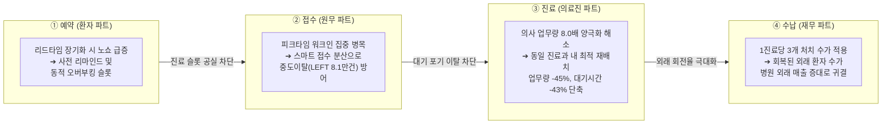

# 📋 [대주제 통합 리포트] 외래 환자 이탈 방지 및 의료 자원(의사·수가) 재배치를 통한 병원 운영 효율화

- **작성팀:** 팀 3 (Team 3)
- **통합 영역:** 외래 진료 라이프사이클 전주기 (예약 ➔ 접수 ➔ 진료 ➔ 수납)

---

## 1. 대주제 추진 배경 및 문제 의식

현대 외래 진료 시스템은 단계별 단절로 인해 심각한 자원 낭비가 발생하고 있습니다:
1. **예약 단계:** 예약 후 진료일까지 리드타임이 길어질수록(21일 이상) 노쇼율이 급증하여 진료 슬롯이 공실로 방치됨.
2. **접수 단계:** 당일 워크인 환자(33%)가 특정 피크 시간대에 몰려 접수 대기시간이 폭증하고, 진료를 포기하고 귀가하는 이탈자(`LEFT` 8.1만 건) 발생.
3. **진료 단계:** 병원별 환자 쏠림으로 특정 병원 의사는 1인당 279명 이상 진료(8.0배 양극화)해 대기시간 19.4분 및 번아웃 초래.
4. **수납 단계:** 앞선 단계에서의 노쇼 및 대기 이탈로 인한 외래 진료비 및 수납 매출 손실 누적.

---

## 2. 4대 소주제 유기적 통합 아키텍처

---

## 3. 종합 비즈니스 성과

1. **데이터 신뢰성:** 전사 17개 테이블 E2E 검증 및 청구-수납 **금융 정합도 99.86%** 확보
2. **자원 재배치 임팩트:** 신규 채용 비용 0원으로 과밀 병원 의사 진료 부담 **-44.9% 경감** (279.3명 ➔ 153.9명)
3. **외래 대기시간 단축:** 과밀 병원 평균 외래 대기시간 **-43.2% 단축** (19.4분 ➔ 11.0분)
4. **병원 경영 가치:** 예약 노쇼 및 대기 이탈 방지를 통한 진료 슬롯 가동률 회복 및 외래 진료 매출 극대화
