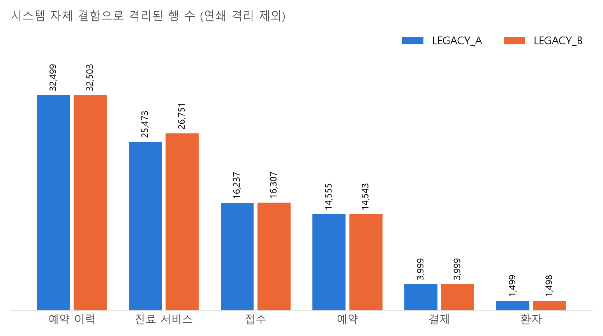
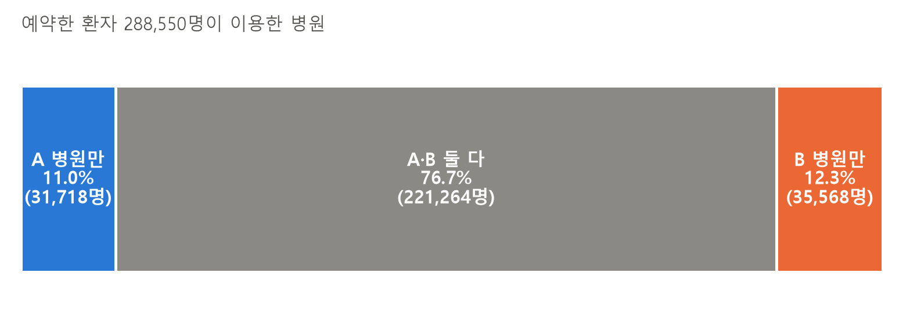
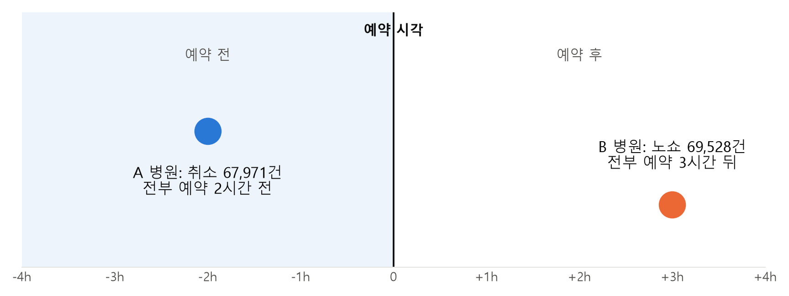

# 레거시 원천 시스템(A/B) 품질 비교와 통합 보고서

- 대주제: 병원 진료 및 수납 시스템 최적화
- 소주제: 레거시 원천 시스템(A/B) 품질 비교와 통합
- 작성: 황유민 / 2026-10-16
- 분석 기간: 2023년 1월 ~ 2025년 12월
- 데이터: 정제된 DB `team3_medallion`(정제본), `team3_medallion_dq`(격리·재정제 기록). 주장 ④의 원본 단가표 오류 파급만 받은 원본 CSV 기준

---

## 요약

**두 기록 시스템(LEGACY_A / LEGACY_B) 중 어느 쪽이 나은가? 하나로 합쳐야 하는가?**

두 시스템은 품질이 같아 어느 쪽이 더 낫다고 말할 수 없다. 하지만 환자 명단이 나뉘어 있고, 취소·노쇼를 파악하는 시점이 다르며, 공통 기준정보의 오류가 두 시스템에 함께 퍼진다. 그래서 최적화를 위해 두 시스템의 장점을 종합한 새 시스템 C로 통합할 것을 권고한다.

| 주장 | 핵심 숫자 | 의미 |
|---|---|---|
| ① 품질은 같고, 기준정보는 이미 하나 | 시스템 자체 결함 A·B 차이 5% 이내 (결제 3,999 vs 3,999), 기준정보 전부 A | 우열을 말할 근거가 없음 |
| ② 병원은 나뉘어 있고, 환자는 오간다 | 한 병원 = 한 시스템 100%, 환자 76.7%가 두 시스템 이용 | 환자 명단이 나뉘어 있음 |
| ③ 같은 20%, 파악 시점이 다르다 | A 취소 20.1%(예약 2시간 전), B 노쇼 20.0%(예약 3시간 뒤) | 시스템 차이로 추정 |
| ④ 기준정보 오류가 두 시스템에 퍼진다 | 단가표 7행 오류 → 진료 서비스 115,590줄, 정제 후 연결 오류 0건 | 통합 전 기준정보 검증이 먼저 |

---

## 1. 분석 배경

받은 레거시 병원 데이터의 모든 테이블에는 `source_system` 컬럼이 있고, 값은 LEGACY_A 또는 LEGACY_B다. 이는 기록이 원래 어느 전산 시스템에 적혀 있었는지를 나타내는 출처 표시다. 명세서상 실제 제품이 아니라 "시스템이 합쳐지는 상황"을 연습하기 위한 가상 출처다.

병원 485곳이 두 시스템으로 나뉘어 있고 같은 환자가 두 시스템 병원을 오가므로, 다음 질문을 세웠다.

1. **품질**: 두 시스템 중 데이터 결함이 더 적은 쪽이 있는가?
2. **구조**: 무엇이 이미 통일돼 있고, 무엇이 나뉘어 있는가?
3. **운영**: 같은 업무를 같은 방식으로 기록하는가?
4. **기준정보**: 공통 기준정보의 오류가 다른 시스템에 영향을 주는가?

## 2. 분석 대상과 기준

- **데이터**: DB는 조회 전용 세션(`SET SESSION TRANSACTION READ ONLY`)에서 SELECT만 실행했다. 데이터와 구조는 수정하지 않았다.
- **품질 기준**: 시스템 자체 결함 = 재정제 격리 기록 중 직접(direct) 격리. 다른 테이블 때문에 함께 빠진 연쇄 격리는 제외했다.
- **파악 시점**: 예약 이력의 기록 시각 − 예약 시각(분).
- **단위**: 테이블별 기록 1건. 환자 비율은 예약 기록이 있는 고유 환자 기준이다.

| 사용 자료 | 역할 |
|---|---|
| `05_source_compare.sql`, `06_source_rank.sql` | 원천별 행 수, 진료 흐름의 원천 일치, 환자 교차 이용 |
| `07_master_link_check.sql` | 정제 후 단가표·진료과 연결 점검 |
| `08_db_facts.sql` | 원천별 직접 격리 건수, 기준정보 원천, 예약 이벤트 시각, 예약 최종 상태 |
| 원본 CSV (`service_catalog`, `encounter_services`) | 원본 단가표 오류 행과 그 행을 참조하는 진료 서비스 줄 수 |

코드와 조회 결과 위치: `data analysis/두기록시스템_비교_통합권고/`

<!-- pagebreak -->

## 3. 주장 ①: 품질은 같고, 기준정보는 이미 하나다

**도표 1.** 시스템 자체 결함으로 격리된 행 수(연쇄 격리 제외). 파랑 LEGACY_A, 주황 LEGACY_B. 출처: `team3_medallion_dq.reclean_quarantine`

| 테이블 | LEGACY_A | LEGACY_B |
|---|---|---|
| 예약 이력 | 32,499 | 32,503 |
| 진료 서비스 | 25,473 | 26,751 |
| 접수 | 16,237 | 16,307 |
| 예약 | 14,555 | 14,543 |
| 결제 | 3,999 | 3,999 |
| 환자 | 1,499 | 1,498 |

| 기준정보 | LEGACY_A | LEGACY_B |
|---|---|---|
| 서비스 단가표 | 180행 | 0행 |
| 진료과 | 12행 | 0행 |
| 코드 사전 | 36행 | 0행 |
| 원천 코드 매핑 | 36개 | 36개 (A와 모두 동일) |

**근거**: 시스템 자체 결함 건수는 A와 B가 거의 같다. 가장 차이가 큰 진료 서비스도 5% 이내다. 기준정보(단가표·진료과·코드 사전)는 전부 A 하나이고, 나뉘어 있는 것은 병원·의사·환자와 예약·접수·진료·결제 기록뿐이다.

**해석 범위**: A/B 중 어느 쪽이 더 낫다고 말할 수 있는 근거는 없다. 통계적으로 동일하다는 검정 결과는 아니다.

## 4. 주장 ②: 병원은 나뉘어 있고, 환자는 오간다

| 항목 | 값 |
|---|---|
| 병원 수 (A : B) | 243 : 242 |
| 병원·진료 구간·접수·진료가 같은 시스템인 진료 | 496,863건 중 100% |
| 다른 시스템에 등록된 환자의 접수 | 843,340건 중 516,138건 (61.2%) |

**도표 2.** 예약한 환자 288,550명이 이용한 병원. A 병원만 31,718명(11.0%), A·B 둘 다 221,264명(76.7%), B 병원만 35,568명(12.3%). 출처: `team3_medallion.appointments`, `patients`

**근거**: 한 병원은 한 시스템만 쓰지만, 환자의 76.7%는 두 시스템 병원을 모두 이용한다. 환자 명단이 두 시스템에 나뉘어 있다.

**해석 범위**: 한 병원 = 한 시스템이므로 A/B 비교는 곧 병원군 비교다. 차이가 시스템 때문인지 병원 특성 때문인지는 구분할 수 없다.

## 5. 주장 ③: 같은 20%, 파악하는 시점이 다르다

| 원천 | 지켜지지 않은 예약 | 예약 이력 기록 건수 | 기록 시점 (예약 시각 기준) |
|---|---|---|---|
| LEGACY_A | 취소 70,889건 (20.13%), 노쇼 0건 | 67,971건 | 전부 2시간 전 |
| LEGACY_B | 노쇼 72,584건 (20.02%), 취소 0건 | 69,528건 | 전부 3시간 뒤 |

**도표 3.** 예약 시각 기준 시간(-4h ~ +4h). 파랑 점은 A 시스템의 취소 기록 시점, 주황 점은 B 시스템의 노쇼 기록 시점. 출처: `team3_medallion.appointments`, `appointment_events`

**근거**: A 시스템은 모든 취소를 예약 2시간 전에, B 시스템은 모든 노쇼를 예약 3시간 뒤에 파악한다.

**해석 범위**: 병원 차이인지 시스템 차이인지 확정할 수는 없지만, 그 비율이 100%인 것으로 보아 시스템 차이로 추정된다. 합성 데이터의 생성 규칙 영향일 수 있다.

## 6. 주장 ④: 공통 기준정보의 작은 오류가 두 시스템에 퍼진다

| 구분 | 내용 |
|---|---|
| 원본 A 단가표 오류 | 180행 중 7행 (음수 단가 4행, ID 표기 오류 3행) |
| 오류 행을 참조하는 진료 서비스 | 115,590줄 (A 60,594줄 · B 54,996줄) |
| 단가표 1행당 영향 | 평균 약 1.7만 줄 |

| 정제 후 DB 점검 | 결과 |
|---|---|
| 단가표 오류 행 | 0행 |
| 단가표에 없는 버전 · 단가 불일치 · 유효기간 밖 버전 | 0줄 (진료 서비스 A 715,143줄 · B 775,446줄 검사) |
| 병원별 진료과·의사의 진료과 연결 오류 | 0건 |

**근거**: 기준정보를 함께 쓰는 구조에서는 기준정보 몇 행의 오류가 두 시스템의 대량 기록에 동시에 영향을 준다. 이 행을 그냥 격리하면 두 시스템 기록이 함께 끊긴다.

**해석 범위**: 정제 후에는 오류 없이 이어진다. 통합 전 기준정보 검증이 먼저라는 근거이며, 실제 운영에서의 손실 규모를 뜻하지는 않는다.

## 7. 결과 종합

| 관점 | 분석 결과 | 의미 |
|---|---|---|
| 품질 | 시스템 자체 결함 건수 A·B 차이 5% 이내 | 어느 쪽이 더 낫다고 말할 수 없음 |
| 구조 | 기준정보(단가표·진료과·코드 사전)는 전부 A, 매핑 36/36 동일 | 기준정보는 이미 하나 → 남은 것은 사람·거래 기록 |
| 구조 | 한 병원 = 한 시스템(100%), 환자 76.7%가 두 시스템 이용 | 환자 명단이 나뉘어 있음 |
| 운영 | 미이행 예약 A 20.1%(취소) · B 20.0%(노쇼) | A는 2시간 전, B는 3시간 뒤 파악 → 시스템 차이로 추정 |
| 기준정보 | 단가표 7행 오류 → 두 시스템 115,590줄 | 공통 기준정보 오류가 다른 시스템까지 오염 |
| 정합성 | 정제 후 기준정보 연결 오류 0건 | 검증을 거치면 하나로 이어질 수 있음 |

우열은 없지만, 환자 명단 · 파악 시점 · 기준정보 오염 때문에 최적화를 위해 두 시스템은 통합해야 한다.

## 8. 통합 권고 (To-Be)

| 권고 | 근거 |
|---|---|
| 1. 두 시스템 중 어느 쪽이 더 좋다고 말할 수는 없다 | 시스템 자체 결함 건수 A·B 차이 5% 이내 |
| 2. 하지만 두 시스템은 통합해야 한다 | 환자 76.7%가 두 시스템 이용 · 취소(2시간 전)/노쇼(3시간 뒤) 파악 시점 차이 · 단가표 7행 오류가 115,590줄에 영향 |
| 3. A·B의 장점을 종합한 새 시스템 C로 통합한다 | 실무자 의견을 바탕으로 장점을 모으고, 환자 명단과 기준정보를 하나로 관리 |

**통합 시스템 C의 구성**

- 단일 환자 마스터 (환자 ID를 한 곳에서 발급)
- 검증된 공통 기준정보 (단가표·진료과·코드)
- 취소·노쇼 파악 시점 기준을 표준으로 통일
- `source_system`은 계보 컬럼으로 유지

**통합 전 검증 단계**: 실무자 의견으로 A·B 장점 선정 → 표준 사전(코드·용어·단위) 확정 → 공통 기준정보 품질 검사 → 정제 규칙 적용

## 9. 결론과 한계

**두 시스템은 품질이 같아 우열을 말할 수 없다. 하지만 기록은 둘로 나뉘어 있다. 그래서 최적화를 위해 장점을 모은 시스템 C로 통합할 것을 권고한다.**

**한계**

- A/B는 명세상 가상의 출처로, 실제 제품을 평가한 것이 아니다.
- 한 병원은 한 시스템만 써서 시스템 차이와 병원 차이를 구분할 수 없다.
- 20%, 2시간 전처럼 딱 떨어지는 합성 데이터라 생성 규칙의 영향이 있을 수 있다.

**보완점**

- 실무자 인터뷰로 두 시스템의 기능 차이 확인
- 같은 병원에서 시스템을 바꾼 기록 등으로 시스템 효과 분리
- 실제 운영 데이터로 재검증
- Gold 테이블 DB 적재와 정기 품질 점검

## 10. 검증·수정 기록

- DB는 조회 전용 세션에서 SELECT만 실행했고 데이터·구조를 수정하지 않았다.
- 처음의 "같은 일을 다른 이름으로 적는다" 해석은 예약 이력 시각(취소는 2시간 전, 노쇼는 3시간 뒤)으로 확인한 결과 서로 다른 사건이라 철회했다.
- "수량 기록 규칙이 다르다" 해석은 같은 서비스 코드의 수량이 A·B 모두 같아 철회했다. 진료당 청구액 차이(1.26배)는 진료 구성 차이다.
- 단가표 오류 파급 줄 수는 완전 중복 행만 제거하는 전체 행 기준으로 다시 세어 115,590줄로 확정했다.
